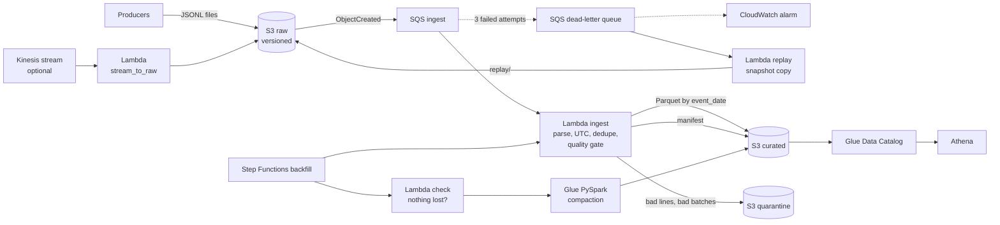

# Event pipeline with recovery

An event-driven AWS data pipeline built around the part most examples skip: what happens when things go wrong.

At Amazon I built and ran pipelines like this one. Sites reported operational events every few minutes, and the
reporting teams depended on every event arriving exactly once, in the right day, even when a batch failed or arrived
late. This repo rebuilds those patterns from scratch with synthetic data so the code can be public. Nothing here
comes from Amazon systems.

**Live run:** deployed with Terraform, exercised with every failure scenario, then torn down.
Results are in [`docs/evidence.md`](docs/evidence.md): 38,541 events received, 0 lost.

## What it handles

| Problem | What the pipeline does | Proven by |
|---|---|---|
| Duplicate events (producer retries) | Collapses by `event_id` within a batch; a dedup view and the compaction job remove duplicates across batches | `test_duplicates_collapse_to_one_row`, Athena query in evidence |
| Late events | Partitions by the time the event happened, not when it arrived, so a late event lands in the right day | `test_late_events_land_in_the_partition_they_happened_in`, 535 late rows in evidence |
| Mixed timezone offsets | Normalizes every timestamp to UTC before choosing the partition | `test_offsets_normalize_to_utc_and_pick_the_utc_date` |
| Bad lines in a good file | Keeps each bad line with a reason in the quarantine bucket; nothing is silently dropped | `test_every_malformed_line_is_kept_with_a_reason` |
| A broken feed | The quality gate quarantines the whole file if more than 5% of lines fail; curated data is untouched | `test_broken_feed_is_quarantined_whole`, scenario 2 |
| A batch that fails every retry | After 3 attempts SQS moves it to a dead-letter queue; a CloudWatch alarm fires; `replay` snapshot-copies it back through the normal path | `test_failed_batch_is_recovered_through_the_normal_path`, scenario 3 |
| Reruns and backfills | One Parquet file per (day, batch), so rerunning a batch overwrites exactly what it wrote before | `test_rerunning_a_batch_changes_nothing`, scenario 4 (totals identical) |
| Proving nothing was lost | Every batch writes a manifest; `check` confirms every raw file has one and every manifest balances | `test_destination_check_flags_unprocessed_objects`, `lost_events: 0` |
| Many small files | A Glue (PySpark) job compacts each day into large files and removes cross-batch duplicates | scenario 5: 10 files to 2, row counts match |

## How it works



- **Ingest** (`src/pipeline/handlers.py`, `transform.py`, `quality.py`): S3 notifies SQS, SQS triggers Lambda one file
  at a time. The parsing and cleaning rules are plain Python with no AWS calls, so every rule has a unit test.
- **Recovery:** `replay` copies the failed raw file to `replay/` first and deletes the DLQ message second, so a crash in
  the middle loses nothing. The copy keeps a pointer to the original key, so it writes the same outputs the original
  would have.
- **Backfill** (Step Functions): lists raw files for a date range, reprocesses them 4 at a time, runs the destination
  check, and only compacts if nothing was lost.
- **Compaction** (`src/glue/compact.py`): Glue 5.0 / Spark. Uses dynamic partition overwrite, so rerunning it for the
  same days gives the same result.
- **Catalog and query:** Glue tables use partition projection, so there is no crawler to wait on and late data is
  queryable immediately. The Athena workgroup caps each query at 1 GB scanned.
- **Streaming (optional):** set `enable_kinesis = true`. Records are batched by Lambda into raw files, one per shard
  per minute, so streamed data gets the same quality gate, recovery, and checks as file input. A retried Kinesis batch
  overwrites the same raw file instead of creating a second one. Tested with mocked AWS; not deployed in the live run
  because the account used does not have Kinesis enabled.

## Security

- One IAM role per function, each limited to the buckets, prefixes, and actions it needs.
  `ingest` cannot read the dead-letter queue; `replay` cannot write curated data; `check` is read-only.
- Every bucket: KMS encryption with a rotating customer-managed key, public access blocked, TLS-only bucket policy.
- The raw bucket is versioned, so an overwrite of the system of record is recoverable.

## Run the tests

No AWS account needed. S3 and SQS are mocked with [moto](https://github.com/getmoto/moto).

```bash
python -m venv .venv && . .venv/bin/activate
pip install boto3 pyarrow "moto[s3,sqs]" pytest
pytest -v
```

20 tests. CI runs them plus `terraform fmt -check` and `terraform validate` on every push.

## Deploy, run the scenarios, tear down

```bash
cd infra
terraform init
terraform apply                    # add -var enable_kinesis=true for the streaming input
cd .. && python scripts/demo.py    # writes docs/evidence.md
cd infra && terraform destroy
```

A full run costs a few cents: Lambda, SQS, and S3 at this volume are near zero, Athena scans a few MB, and the Glue
job runs about 80 seconds on 2 workers. The KMS key is about $1/month while the stack exists.

## Trade-offs I made

- **One file per (day, batch) instead of appending to one file per day.** Reruns are safe and two batches never race
  on the same object. The cost is many small files, which the compaction job fixes.
- **Batch size 1 on the SQS trigger.** One bad file can never hold up or roll back a good one. At higher volume I would
  raise the batch size and use partial batch responses.
- **Quality gate on the whole file.** A feed that is mostly garbage usually means the producer is broken, and loading
  the 5% that parsed would hide that.
- **Snapshot copy instead of re-driving the original message.** The replay reads a fixed copy, so a later overwrite of
  the original raw file cannot change what gets recovered.
- **`__force_failure__` demo hook.** A raw file containing this line fails ingest on purpose, so the DLQ path can be
  shown on demand. Replay strips it. A real pipeline would not have it.

## Layout

```
src/pipeline/   generator, transform, quality, storage, handlers (Lambda)
src/glue/       compact.py (Glue PySpark job)
infra/          Terraform: storage, queues, Lambdas, Step Functions, Glue, Athena, IAM, alarm
tests/          pytest with moto
scripts/demo.py live scenarios against a deployed stack
docs/           evidence from the live run
```
